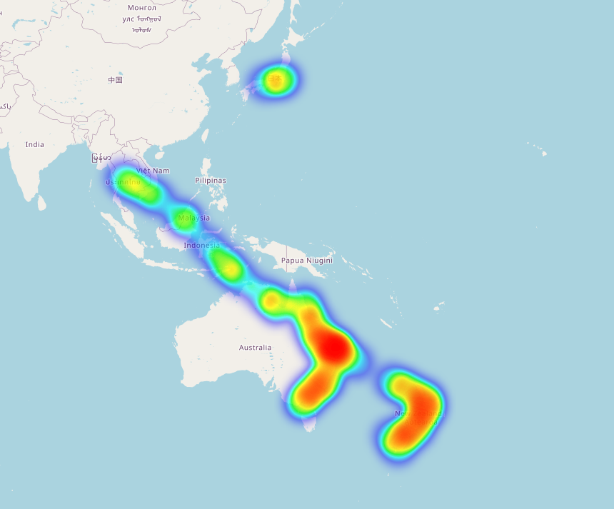

# Google Maps Timeline Data Parser

A Python script that reads your Google Maps Timeline exports into one SQLite database and tells you what they cover.

- Reads the files a phone exports today **and** the older Google Takeout files, and works out which is which from their contents.
- Prints a month-by-month coverage report: how much data each month really holds, and where the gaps are.
- Opens a map in your browser, drawn straight from the database: pick any day, week, month or year and see your lines, visits, individual readings or a heatmap. No files are generated.
- Turns the scatter of readings into lines that follow where you went (see "From dots to lines" below).
- Creates a heatmap of the places you've been to.
- Creates a GPX track, cut wherever the data has a gap, for apps such as Fog of World.
- Adds up distance, both from the track and from Google's own estimate per travel mode.



## Getting your data

Google now keeps Timeline on each phone, not in your account, so export from every phone that still has history.

- **Android:** Settings → Location → Location services → Timeline → Export Timeline data. This usually writes `Timeline.json`.
- **iPhone / iPad:** Google Maps → your profile picture → Settings → Location & Privacy → Export Timeline data. This usually writes `location-history.json`.
- **Older Google Takeout downloads**, if you still have one: `Records.json` (or `Location History.json`), the `Semantic Location History` folder and `Timeline Edits.json`. You can give the script the Takeout ZIP itself.

## Usage

```bash
python main.py PATH [PATH ...] [options]
```

Each `PATH` can be a JSON file, a Takeout ZIP archive, or a folder (every JSON file and ZIP inside it is tried). Files that are not Timeline data are skipped.

```bash
# Import everything in a folder and see what it covers, counting days in your time zone
python main.py ~/timeline-exports --coverage --tz Australia/Brisbane

# Browse it on a map (then open http://127.0.0.1:8765/)
python main.py --serve --tz Australia/Brisbane

# Report again later without importing anything
python main.py --coverage --coverage-csv coverage.csv

# A GPX track and a heatmap for one year
python main.py --gpx --heatmap --from 2019-01-01 --to 2020-01-01
```

| Option | What it does |
| --- | --- |
| `--db PATH` | SQLite database to use (default `timeline.db`) |
| `--coverage` | Print the coverage report |
| `--coverage-csv PATH` | Write the month-by-month table to a CSV file |
| `--tz ZONE` | Time zone for counting days and months, for example `Australia/Brisbane` (default UTC) |
| `--gpx`, `--gpx-out PATH` | Write a GPX track (default `timeline.gpx`) |
| `--distance` | Print the distance along the track |
| `--heatmap`, `--heatmap-out PATH` | Write an interactive heatmap (default `travel_heatmap.html`) |
| `--from DATE`, `--to DATE` | Limit GPX, distance and heatmap to a UTC date range |
| `--max-gap-minutes N` | Cut the track where readings are further apart than this (default 30) |
| `--max-accuracy METRES` | Leave out readings less accurate than this (default 200) |
| `--raw` | GPX and distance use the readings as recorded, without the clean-up |
| `--serve`, `--port N` | Open the map viewer on this computer (default port 8765) |

Importing is safe to repeat. A file already imported is recognised by its fingerprint and skipped, and a newer export that repeats older history adds only the new records.

### Optional packages

The script runs on the Python standard library alone. Two packages add features:

```bash
pip install -r requirements.txt
```

- `folium` is needed for the heatmap.
- `ijson` reads a large `Records.json` piece by piece. Without it the whole file is loaded into memory, which is slow for files of hundreds of megabytes.

## The map viewer

`python main.py --serve` starts a small web server on your own computer and prints the address to open. It reads the database directly, so there is nothing to regenerate after an import: reload the page instead.

- **◀ ▶** (or the arrow keys) jump to the previous or next day that has data. **Show…** widens the view to the week, month or year around the From date, or everything.
- **Lines** draws your movements, one colour per day. Click a line for its times and length.
- **Clean up** switches between the cleaned line and the readings as recorded.
- **Readings** shows every individual reading as a dot; **Visits** shows the places Google recorded you stopping at; **Heatmap** shows where you spend time.

Long periods are drawn with fewer points so they stay quick: a year of a million-reading history takes about a second and a half on a laptop, and is remembered after that.

The server only answers this computer, opens the database read-only, and refuses requests that name any other host, so other web pages cannot read your history through it. Stop it with Ctrl+C.

## From dots to lines

Phone readings wobble: standing still produces a cloud of points tens of metres wide, a bad Wi-Fi or mobile-tower reading throws a single point kilometres away, and every reading is only accurate to within its accuracy radius. Joined up as they are, they make a scribble and add up to far more distance than you travelled. The clean-up, used by the map, the GPX file and `--distance` unless you pass `--raw`, does five things in order:

1. **Removes spikes**: a single reading that jumps far away and straight back.
2. **Cuts the line** at a long silence (`--max-gap-minutes`) or an impossible speed, instead of drawing a straight line across it.
3. **Collapses stays**: readings within 60 metres of each other for 4 minutes or more become one spot, kept at your arrival and departure times.
4. **Smooths the wobble** with a Kalman filter and a backward pass. It trusts each reading according to its accuracy and allows sharper turns at higher speeds, so walks are straightened out without cutting the corners off a drive.
5. **Simplifies**, dropping points that add no shape (5 metres for a single day, more for longer periods).

It does not snap lines to roads. That needs a road map and a routing engine (such as OSRM or Valhalla) running on your own computer, because sending your history to an online routing service would hand it over.

On made-up test data, a 2 km walk read every 15 seconds with about 10 metres of wobble measures more than 2.4 km raw and 1.9 to 2.2 km cleaned, drawn with a quarter of the points.

## What goes where

Different kinds of record stay in different tables, because they are different kinds of evidence. Every row has a `source_id` pointing to the file it came from. All times are stored in UTC, both as text and as milliseconds since 1970.

| Table | What a row is | Comes from |
| --- | --- | --- |
| `positions` | One location reading (GPS, Wi-Fi or mobile tower), with its accuracy in metres | `Records.json`; `rawSignals` in a phone export; `Timeline Edits.json` |
| `path_points` | One point on a route Google kept for a movement | `timelinePath` in a phone export; the timed path in old monthly files |
| `visits` | A stay at a place, as Google worked it out or you corrected it | Phone export; old monthly files (which also give a name and address) |
| `activities` | A movement, with Google's travel mode and distance | Phone export; old monthly files |
| `frequent_places` | Places the phone has labelled, such as home and work | Phone export |
| `source_files` | Each imported file, its fingerprint, and what was not kept and why | |

A database made by an earlier version of this script has a single `timeline` table. It is left untouched and no longer used; import your files again to fill the new tables.

## How to read the results

- **The coverage report comes first.** Each kind of record has its own date range. Seeing 2013 in Google Maps does not mean detailed readings from 2013 survived. A day with no record means there is no evidence, not that you stayed home.
- **A visit is Google's best guess** at the place, and can be the shop next door. A reading's accuracy figure is a radius, not a guarantee.
- **Distances are estimates.** `--distance` adds up straight lines between readings. The coverage report's distance by travel mode is Google's own figure for each movement. They measure the same travel in two ways, so never add them together.
- **Cleaned distance is shorter than raw distance**, because wobble and spikes no longer count as travel.
- **The track uses one source per day.** Where a day has both location readings and route points, only the denser one is used, so the same trip is not drawn twice.
- **Wi-Fi scans, activity guesses and inferred untimed routes are not imported.** The import summary lists how many records of each kind were left out.

## Privacy

Your location history shows where you live, work and sleep. This script works entirely on your own computer and sends no location data anywhere. The map viewer and the heatmap file load map pictures from OpenStreetMap and the map library from unpkg.com, so those services see which areas you look at (not your history). The exports, the database and everything the script writes are listed in `.gitignore`; keep them out of any repository or shared folder.

## Tests

```bash
pip install pytest
python -m pytest tests
```

The tests use made-up data at public landmarks.
